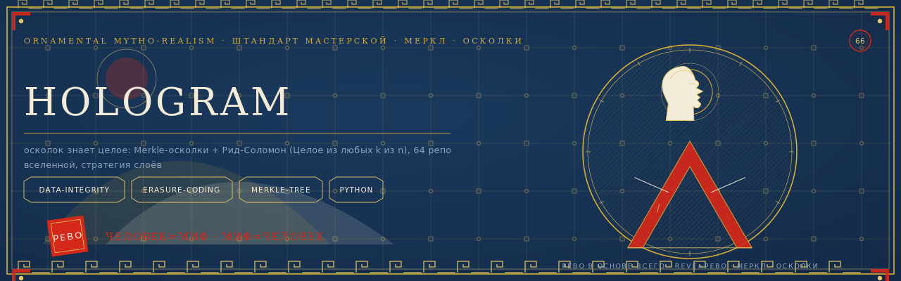
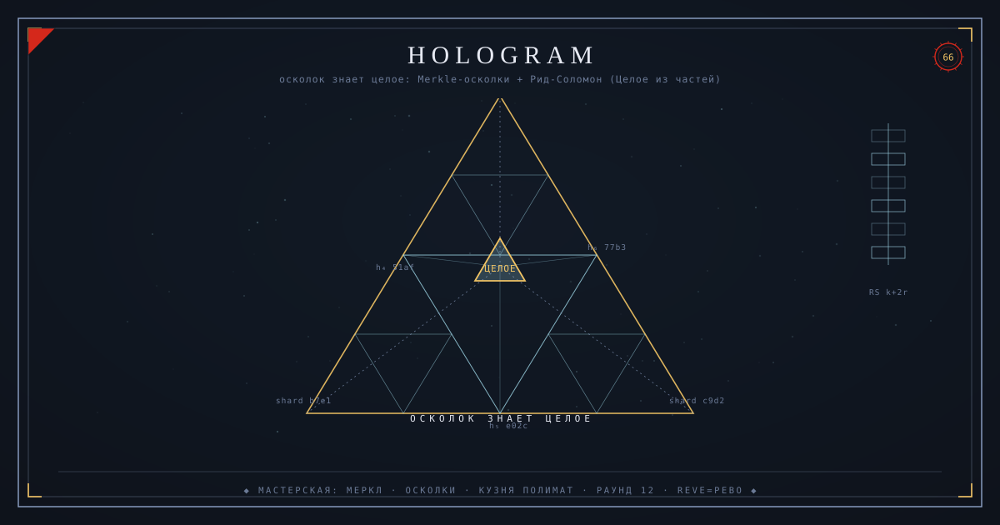

  

<!--ФОРЖ:МУЗА:НАЧАЛО-->

  
   
  

<!--ФОРЖ:МУЗА:КОНЕЦ-->

# hologram — осколок знает целое

Один файл `hologram.py`, stdlib. Три команды:

    python3 hologram.py build --r 5    # hologram/<repo>.json — положить в корень каждого репо
    python3 hologram.py verify         # проверка + подмена записи отвергается
    python3 hologram.py curve          # curve.csv + curve.svg

В каждом осколке: корень Merkle целого, ПОЛНЫЙ индекс (имя+хэш всех репо), своя запись
и ещё r-долю чужих записей (rendezvous hashing, без координатора). Любые k осколков
собирают целое; всё сверяется по хэшам, подмена не проходит.

Честные границы:
- это избыточность + проверка по хэшам, не erasure coding: резкость растёт с k, а не «любые k из n дают всё»;
- в этом прогоне вселенная = 32 репо из universe.json (API GitHub дал rate limit);
  у тебя `python3 hologram.py build` сам возьмёт все 64 (опционально `GITHUB_TOKEN`);
- «плоть» = записи name/desc/lang/cluster, не содержимое репо.

Результат прогона (n=32): r=5 -> 1 осколок даёт 18% плоти и 100% имён/хэшей; k=n/3 -> 92%;
95% при k=12. r=3 -> 79% при n/3; r=1 -> 53%.

## Карта документов

- `STATUS.md` — числа прогонов (append-only): вселенная n = 66, k = ceil(n/3) = 22, r = 3.
- `STRATEGY.md` — стратегия слоёв.
- `curve.csv` / `curve.svg` — кривые плотности восстановления (обычная ветка), `curve_ec.*` — ветка Рида—Соломона.
- `doors.json` — нумерация дверей дома (52 двери; Door Zero вне нумерации).
- `hologram.py` — stdlib-осколки (избыточность + проверка по хэшам), `hologram_ec.py` — ветка избыточного кодирования.
